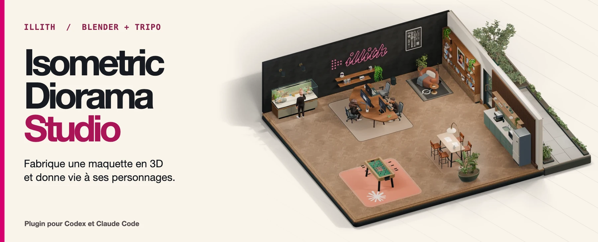
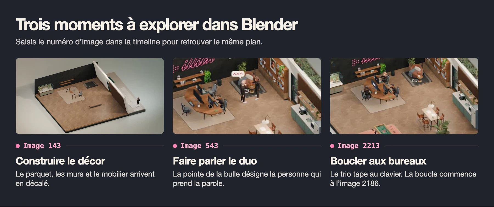

# Isometric Diorama Studio

[](showcase/scene/README.md)

**Une pièce se construit sous tes yeux.** Une collègue pousse la porte, deux joueurs suivent la balle au baby-foot et un poisson bondit hors de l’eau. Ce dépôt te donne la scène Blender du film et le plugin qui reprend la méthode de fabrication pour créer tes propres miniatures avec Codex ou Claude Code.

**[Télécharger la scène complète · 171 Mo](https://github.com/ohvignas/isometric-diorama-studio/releases/download/v1.1.0/Coworking-Illith-source.blend)**　·　**[Voir le film · 1 min 30](showcase/coworking-1080.mp4)**　·　**[Installer le plugin](#installer-le-plugin)**

## Ta première visite dans Blender

1. Télécharge **Coworking-Illith-source.blend** et ouvre-le dans **Blender 5.2.3 LTS**, la version utilisée pour le contrôle. Les trois personnages, leurs squelettes, les meubles et les **297 textures** sont dans ce fichier. Blender seul suffit pour explorer le film.
2. Dans la barre de temps en bas, clique sur le **numéro d’image courant**, saisis **101**, puis appuie sur **Entrée**. Appuie sur **Espace** pour voir la construction. Une seconde pression met la lecture en pause.
3. Essaie **233** pour voir la conceptrice pousser la porte ou **905** pour observer les joueurs. Pour voir la lumière, les matières et le cadrage final sur une seule image, choisis **Rendu → Rendre l’image**. [Visite guidée de la scène](showcase/scene/README.md)

[](showcase/scene/README.md)

**Tu veux modifier quelque chose pour la première fois ?** Ouvre le petit atelier, enregistre une copie, sélectionne un meuble dans la vue 3D et appuie sur **G**, puis **X** pour le déplacer le long d’un axe. Clique pour poser le meuble. Le générateur Python permet aussi de reconstruire cet exercice depuis zéro. [Télécharger l’atelier léger](https://github.com/ohvignas/isometric-diorama-studio/releases/download/v1.1.0/atelier.blend) · [Suivre l’exercice](plugins/isometric-diorama-studio/docs/atelier.md)

## Installer le plugin

Choisis le terminal de ton client. Les deux commandes ajoutent le catalogue **illith-tools**, puis le plugin.

**Codex**

```sh
codex plugin marketplace add ohvignas/isometric-diorama-studio
codex plugin add isometric-diorama-studio@illith-tools
```

**Claude Code**

```sh
claude plugin marketplace add ohvignas/isometric-diorama-studio
claude plugin install isometric-diorama-studio@illith-tools
```

Ouvre une nouvelle conversation. Pour agir sur Blender, installe le connecteur **Blender Lab** et active son extension dans Blender. Pour générer un nouveau personnage, connecte le compte **Tripo Studio** ou le compte **API** qui détient tes crédits. Pour exporter la vidéo, le kit utilise FFmpeg. [Brancher les outils pas à pas](plugins/isometric-diorama-studio/docs/connexion.md)

**Premier prompt à copier**

> Utilise Isometric Diorama Studio. Ouvre une copie de l’atelier d’exercice. Montre-moi la caméra et le mannequin. Rends une image de ses mains sur le clavier, puis indique quel os sélectionner pour lever sa main droite. Travaille avec les modèles déjà fournis.

## Comment les gestes ont été construits

Dans la scène, va à l’image **905**. Les visages des deux joueurs suivent la balle. Passe à **1248**, après le but, et leurs regards se rejoignent. La planche de contrôle montre les yeux en gros plan et la direction suivie par chaque joueur. [Voir la planche des regards](showcase/guide/regards-babyfoot.jpg) · [Lire le carnet de fabrication](plugins/isometric-diorama-studio/docs/cas-illith.md)

| Ce que tu veux faire | Guide du plugin |
| --- | --- |
| Choisir le cadre, le trajet et la dernière pose | [Cadrage et scénario](plugins/isometric-diorama-studio/skills/diorama-cadrage/SKILL.md) |
| Créer un personnage avec Smart Mesh P2.0 et vérifier sa texture | [Personnage Tripo](plugins/isometric-diorama-studio/skills/tripo-personnage/SKILL.md) |
| Adapter la marche à une autre taille, contrôler les pieds et les coudes | [Mouvement humain](plugins/isometric-diorama-studio/skills/blender-tripo-mouvement/SKILL.md) |
| Construire la pièce, placer les meubles, éclairer le néon | [Décor et éclairage](plugins/isometric-diorama-studio/skills/diorama-decor/SKILL.md) |
| Faire saisir une poignée ou asseoir un personnage | [Interactions](plugins/isometric-diorama-studio/skills/diorama-interactions/SKILL.md) |
| Exporter un film transparent avec son ombre et une boucle web | [Livraison web](plugins/isometric-diorama-studio/skills/diorama-livraison/SKILL.md) |

## Ressources du projet

- **Pour regarder** · [Construction en GIF](showcase/construction.gif) · [Film 1080p](showcase/coworking-1080.mp4) · [Boucle finale de trois secondes](showcase/boucle-bureau.mp4)
- **Pour fabriquer** · [113 sources et tutoriels](plugins/isometric-diorama-studio/docs/sources.md) · [Origine des meubles, plantes, livres et textures](plugins/isometric-diorama-studio/docs/credits.md) · [Poisson 3D d’exercice](plugins/isometric-diorama-studio/examples/PROVENANCE.md)
- **Pour vérifier** · [Contrôle de la scène publiée](showcase/scene/controle.json) · [Tests des connecteurs, des mouvements et du lecteur](tests/README.md) · [Instructions des agents](AGENTS.md)

Le logiciel et le petit atelier sont sous licence MIT. Le coworking complet est partagé pour ouvrir la scène et étudier sa fabrication. Les décors de bibliothèque, captures de mouvement, illustrations, personnages et marques de la production ont leurs propres conditions. [Licence du code](LICENSE) · [Provenance de la scène](showcase/scene/README.md)
