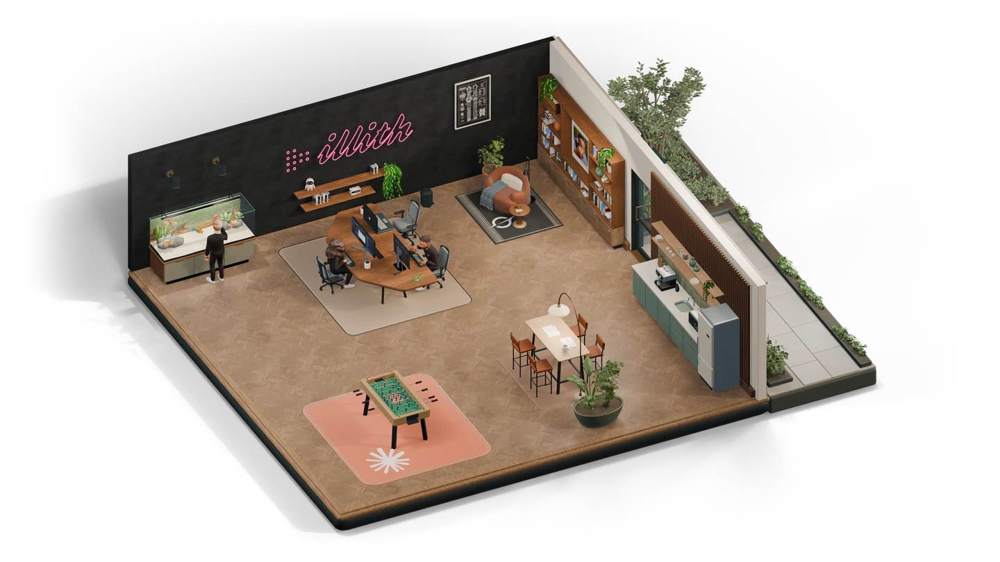

# Le coworking Illith

Le parquet et les murs se construisent, la conceptrice rejoint ses collègues, puis l’équipe se retrouve aux bureaux. Le film et la boucle s’utilisent indépendamment.

| Fichier | Usage |
| --- | --- |
| [Film complet en 1080p](coworking-1080.mp4) | Introduction de 2 157 images à 24 images/s, H.264 |
| [Boucle aux bureaux](boucle-bureau.mp4) | Trois secondes, 72 images en 1080p pour la lecture continue |
| [Construction](construction.gif) | Aperçu animé des six premières secondes |
| [Poster](coworking.webp) | Image du décor achevé |

Le [carnet de production](../plugins/isometric-diorama-studio/docs/cas-illith.md) explique les prises de mouvement et la chronologie. L’[atelier Blender](../plugins/isometric-diorama-studio/examples/atelier.blend) permet de refaire le parcours avec des objets modifiables. Les rendus de cette page présentent le projet Illith. Les conditions du mobilier, des personnages et des marques figurent dans les [crédits](../plugins/isometric-diorama-studio/docs/credits.md).

La [scène Blender de production](https://github.com/ohvignas/isometric-diorama-studio/releases/download/v1.1.0/Coworking-Illith-source.blend) contient le coworking complet avec les trois personnages. La [visite illustrée](https://github.com/ohvignas/isometric-diorama-studio/tree/main/showcase/scene) donne les images à explorer.
