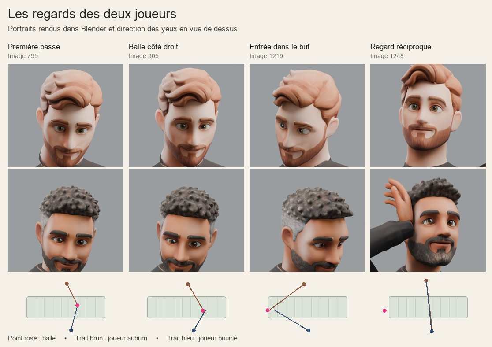

# Ouvrir le coworking du film

**[Télécharger Coworking-Illith-source.blend · 171 Mo](https://github.com/ohvignas/isometric-diorama-studio/releases/download/v1.1.0/Coworking-Illith-source.blend)**

Ce fichier est une copie du master de production avec fond transparent. Il s’ouvre dans Blender avec le trio Tripo, Illibot sur son étagère, le mobilier, les deux poissons, les lumières et les animations du film. Les deux vues du parcours de la conceptrice utilisent des armatures distinctes. On compte sept armatures au total dans la scène.

## Regarder la scène

Ouvre le fichier avec **Blender 5.2.3 LTS**. La vue caméra montre le décor déjà construit. Dans la timeline, saisis **101** comme image courante pour recommencer. Utilise **Espace** pour lire ou mettre en pause. Pour retrouver la caméra après avoir tourné autour d’un objet, choisis **Vue → Caméras → Caméra active** dans la vue 3D. Pour voir le film à sa cadence de 24 images/s sur une machine qui peine à le prévisualiser, ouvre le [MP4 rendu](../coworking-1080.mp4).

| Image Blender | Ce qu’il faut observer |
| ---: | --- |
| 143 | Des éléments du sol et des murs sont déjà en place. Le mobilier continue d’arriver. |
| 233 | La main de la conceptrice accompagne la poignée vers l’intérieur. |
| 543 | La pointe de la bulle indique qui parle. |
| 905 → 1248 | Les yeux des joueurs passent de la balle au visage de leur collègue. |
| 1453 → 1467 | Le collègue nourrit le poisson et celui-ci bondit. |
| 1852 → 1919 | L’espresso se prépare, la conceptrice lit et son collègue boit. |
| 2186 → 2257 | Les trois collègues travaillent. Ces 72 images forment la boucle finale. |



## Explorer l’animation d’un personnage

Enregistre une copie de travail. Dans l’Outliner, la liste d’objets en haut à droite, recherche **Entrée · armature de la conceptrice**. Sélectionne l’armature, passe en **Mode pose** et active **Afficher les superpositions** pour voir les os. Avance de quelques images autour de **233**. Dans un éditeur **Dope Sheet**, les losanges indiquent les poses enregistrées. Le [guide du mouvement humain](../../plugins/isometric-diorama-studio/skills/blender-tripo-mouvement/SKILL.md) explique ensuite comment capturer une prestation et la transférer à un autre personnage.

## Contenu et vérification

Le fichier couvre les images **101 à 2257**, soit **89,875 secondes**. Il contient **3 713 objets**, **865 actions**, **3 995 courbes d’animation** et **1 721 055 clés**. Les **297 images de texture et de composition** sont intégrées, avec les trois atlas de personnages en **4096 × 4096**. Les chemins de travail du poste ont été retirés de la copie distribuée. Le fichier est publié dans les téléchargements de la version GitHub pour garder l’installation du plugin légère.

La scène publiée a été rouverte dans Blender. Les courbes, les positions de leurs clés et de leurs poignées correspondent au master. Les poses évaluées des armatures correspondent aux cinq images de contrôle. Blender signale zéro fichier manquant. Sur un rendu EEVEE de l’image 905 en 563 × 316, l’écart maximal mesuré avec le master est d’un niveau sur 255 par canal RGBA. Le [rapport JSON](controle.json) donne les résultats, les noms d’armatures et les repères du montage. Pour refaire la mesure, depuis le dépôt cloné, lance la commande suivante.

```sh
blender -b --factory-startup -Y Coworking-Illith-source.blend --python-exit-code 4 -P showcase/scene/verify_scene.py -- controle-local.json
```

## Crédits de la scène

L’équipe, Illibot, l’identité visuelle et la mise en scène appartiennent au projet Illith. Les personnages ont été générés dans Tripo Studio à partir du casting fourni. La marche du film s’inspire de la prestation Xbot adaptée aux appuis de chaque personnage. Le salut et le lever utilisent des prises Carnegie Mellon. Les actions intégrées sont celles du montage. [Termes Tripo](https://www.tripo3d.ai/terms) · [Provenance des mouvements](../../plugins/isometric-diorama-studio/skills/blender-tripo-mouvement/references/coworking-illith.md)

Les meubles, livres, plantes et matériaux de bibliothèque sont crédités objet par objet. Les logos et illustrations intégrés, dont le visuel Starship fourni et la vignette du mème de 2023 dans la bibliothèque, conservent leurs droits respectifs. La licence MIT porte sur le code et le petit atelier pédagogique. [Crédits des modèles et textures](../../plugins/isometric-diorama-studio/docs/credits.md) · [Source de la vignette](https://www.reddit.com/r/StableDiffusion/comments/1244h2c/will_smith_eating_spaghetti/) · [Licence Poly Haven](https://polyhaven.com/license)
